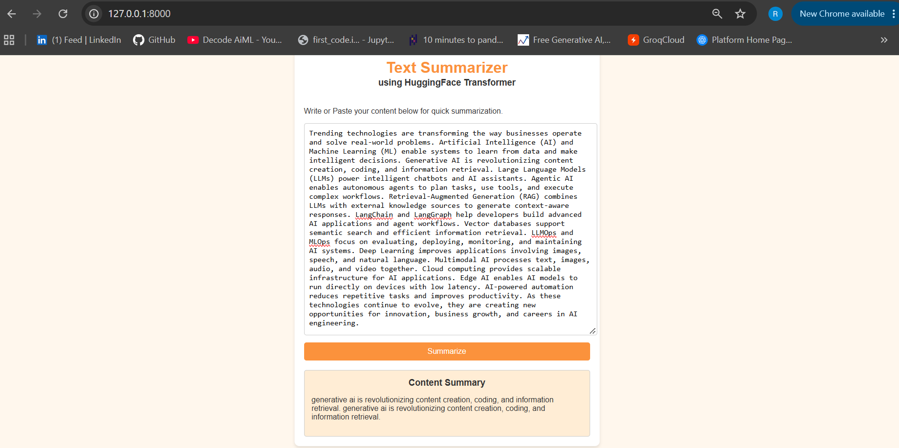

# 📝 Text Summarizer using T5

A web-based text summarization application that uses a fine-tuned **T5 Transformer model** to generate concise summaries from long text. Built with **PyTorch, Hugging Face Transformers, FastAPI**, and a simple web interface.

## What it does

1. Accepts long-form text from the user.
2. Preprocesses and tokenizes the input using the **T5 Tokenizer**.
3. Generates a concise summary using a fine-tuned **T5 model**.
4. Provides the generated summary through a FastAPI backend.
5. Offers a simple web interface for easy text summarization.

## 📸 Application Screenshots

### Text Summarizer


## Tech stack

- **Python**
- **PyTorch**
- **Hugging Face Transformers**
- **T5 (Text-to-Text Transfer Transformer)**
- **NLP**
- **FastAPI**
- **Jinja2 Templates**
- **HTML / CSS / JavaScript**
- **Uvicorn**
- **Git & GitHub**

## Project structure

```text
TEXT-SUMMARIZER/
│
├── app/
│   ├── main.py                  # FastAPI application
│   │
│   ├── templates/
│   │   └── index.html           # Web UI
│   │
│   └── static/
│       ├── style.css            # UI styling
│       └── script.js            # Frontend logic
│
├── model/
│   └── saved_summary_model/     # Fine-tuned T5 model
│
├── notebooks/
│   ├── data_preprocessing.ipynb
│   ├── tokenization.ipynb
│   ├── model_training.ipynb
│   └── model_evaluation.ipynb
│
├── requirements.txt
├── .gitignore
├── README.md